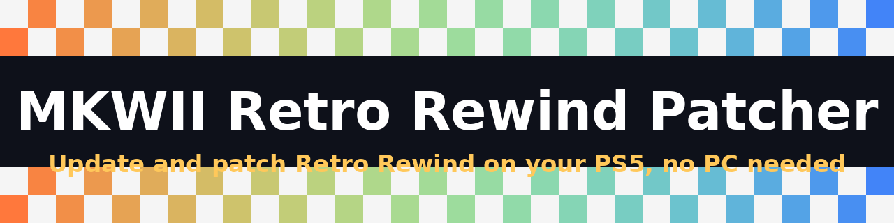
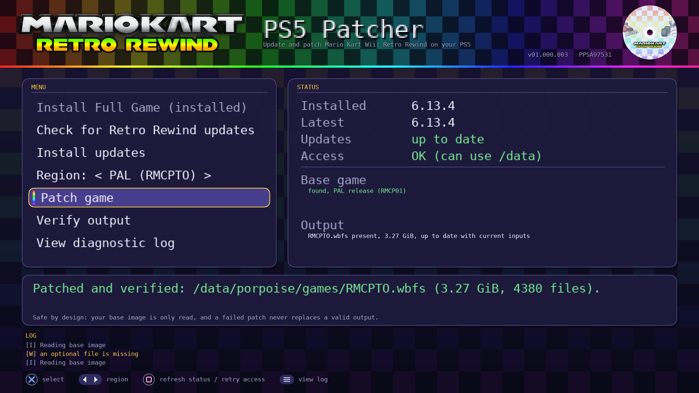

<p align="center"></p>

<p align="center"></p>

<p align="center">
  <a href="../../releases/latest"></a>
  
  <a href="../../actions/workflows/build.yml"></a>
  
</p>

**Install, update and patch Retro Rewind for Mario Kart Wii entirely on your PS5, with a controller.**

[Install](#install) · [Usage](#usage) · [Controls](#controls) · [Troubleshooting](#troubleshooting) · [Build](#build-from-source) · [Credits](#credits) · [Donate](#support-the-project)

## What it is
A native PS5 app. It installs the official [Retro Rewind](https://rwfc.net) pack, keeps it up to date, and builds a patched
Mario Kart Wii `.wbfs` from **your own** copy of the game. No PC needed.

## Features
- **Install Full Game:** one button installs everything Retro Rewind needs when it is missing: the builder tools from this repository (`builder/`) and the complete official pack. All folders are created for you.
- **Updates:** checks the official server and installs only the newest update, merged into your pack (files replaced or added, nothing else touched).
- **Patching:** builds `RMCETO` (USA), `RMCPTO` (PAL) or `RMCJTO` (Japan) after you pick the region.
- **Safe:** your original image is only ever read. A failed patch never overwrites a good output (temporary file, full verify, then atomic rename).
- **Verify:** re-check the finished image from the menu.
- **Internal storage only:** everything lives in `/data/porpoise/...`, nothing on USB.
- **Any file name:** any `.wbfs` in the base folder is accepted.
- **Diagnostic log:** shows exactly what failed and why.

## Requirements
- A jailbroken PS5 running [ShadowMountPlus](https://github.com/drakmor/ShadowMountPlus) and OnionHEN.
- Your own legally obtained Mario Kart Wii image as a `.wbfs` file.
- An FTP client (or another way to copy files to the console) and an internet connection.
- Free internal space of roughly one game image plus the Retro Rewind pack.

## Install
1. **Download** `PPSA97531.zip` from the [latest release](../../releases/latest).
2. **Unzip** it. You get a folder `PPSA97531` containing `eboot.bin`, `sce_module/` and `sce_sys/`.
3. **Copy** that whole folder to `/data/homebrew/PPSA97531/` on the console (FTP). Wait about 15 seconds; ShadowMountPlus registers it and the app shows up on the home screen.
4. **Allow the app in OnionHEN.** Without this the app cannot read or write `/data`. Add the title ID `PPSA97531` in
   **both** `/data/OnionHEN/config.ini` and `/user/data/OnionHEN/config.ini`:
   ```
   [app_jailbreak]
   enabled=true
   exact_title_ids=ITEM00001,NPXS39041,PKGI13337,PKGI12345,TOOL00001,PPSA97531
   ```
   Keep the IDs already in your list and append `,PPSA97531`. Then restart OnionHEN.
5. **Permissions.** Start the app once so it creates `/data/porpoise`, then set `/data/porpoise` and everything in it to **777**
   (recursively) in your FTP client. If you skip this, installing fails with "cannot create working folders".
6. **Put your game in place:** copy your Mario Kart Wii image (one `.wbfs`, any name) to `/data/porpoise/rewind/base/`.
7. **Start the app** and choose **Install Full Game**. If the Access row does not show OK, press Square to retry.

Already have your own Retro Rewind pack or builder files? Put them in `/data/porpoise/rewind/pack/RetroRewind6/` and
`/data/porpoise/rewind/builder/` yourself and skip Install Full Game.

## Usage
1. **Install Full Game** (only while no Retro Rewind pack is installed; greyed out otherwise).
2. **Check for Retro Rewind updates**, then **Install updates**.
3. Choose your **region** with Left/Right (USA, PAL or Japan). It must match your base image.
4. **Patch game.** The result is `RMCETO.wbfs` (USA), `RMCPTO.wbfs` (PAL) or `RMCJTO.wbfs` (Japan) in `/data/porpoise/games/`.
5. Optionally **Verify output**, then start the game from your game launcher.

## Controls
| Button | Action |
|---|---|
| **Up / Down** | Select menu item |
| **Cross** | Activate |
| **Left / Right** | Change region |
| **Circle** | Cancel the running job |
| **Square** | Refresh status / retry access |
| **Options** | Open the log |

## Where things are kept
| Path | What |
|---|---|
| `/data/homebrew/PPSA97531/` | The app |
| `/data/porpoise/rewind/base/` | Your base game image |
| `/data/porpoise/rewind/pack/RetroRewind6/` | Retro Rewind pack (`version.txt` inside) |
| `/data/porpoise/rewind/builder/` | Builder scripts and assets |
| `/data/porpoise/games/` | Output (`RMCETO` / `RMCPTO` / `RMCJTO.wbfs`) |
| `/data/porpoise/rewind/state/` | Region choice and patch fingerprint |
| `/data/porpoise/rewind/logs/porpoise.log` | Log file |

## Troubleshooting
- **Cannot open the base folder / no game found.** The app is not allowed in OnionHEN yet (step 4), or the base folder has no `.wbfs`.
- **"Cannot create working folders".** Folder permissions (step 5).
- **"Cannot read builder script".** The builder files are missing. Move the pack folder away and run **Install Full Game**, or copy the builder files into `/data/porpoise/rewind/builder/` yourself.
- **"Retro Rewind is not installed yet" when checking for updates.** Use **Install Full Game** first.
- **Install Full Game is greyed out.** A pack is already installed. To reinstall, delete `/data/porpoise/rewind/pack/RetroRewind6/` first.
- **Install Full Game fails.** Check the Access row and free space, then press Options for the log.
- **Image not recognised.** Rename it `RMCE01.wbfs`, `RMCP01.wbfs` or `RMCJ01.wbfs`.
- **Anything else.** Press Options for the log, or read `/data/porpoise/rewind/logs/porpoise.log`, and include it in an issue.

## Known limitations
- Only the newest update archive is installed. The server publishes one archive per release containing that release's changes, so if your pack is several releases behind, files that only older archives carried can be missing. In that case reinstall the pack (see Troubleshooting).
- Delete lists inside update archives are not applied (merge only).
- If the pack has no files for some languages (for example `Language/*/Font`), the patch skips them like the official builder and notes it in the log; the game keeps its original files for those.
- The app needs the OnionHEN allowlist entry; it cannot work in a plain sandbox.
- The app never downloads your game. It downloads the Retro Rewind archives from `update.rwfc.net` and the builder tools from this repository.

## Build from source
See [docs/BUILD.md](docs/BUILD.md). Deploy details: [docs/DEPLOY.md](docs/DEPLOY.md). Host tests: `tests/run_all.sh`.
The builder tools the app installs live in [`builder/`](builder/) (see its [notice](builder/NOTICE.md)).
Releases are built by GitHub Actions when a version tag such as `01.000.000` is pushed.

## Support the project
This is free and open source. If it saved you time and you want to say thanks, you can donate:

| Network | Address |
|---|---|
| **Solana (SOL)** | `CzbwBTYjgYPbny5zdjVJKrrtySVWdUvSWYYtC2x9qSB` |
| **Ethereum (ETH)** | `0x8146E8855096C19BaF164FFF88326d5062863C6f` |

Always copy the address from this page. Never send funds because of a message or comment from someone else.

## Credits
- **Retro Rewind** is the work of the [Retro Rewind Team](https://rwfc.net).
- **Builder tools** (`builder/`): scripts by **Wiimm** (built on [Wiimm's ISO Tools](https://wit.wiimm.de)), maintained as *Kote's ISO patcher for Retro Rewind* by **Kote** and the Retro Rewind Team
  ([source](https://github.com/Retro-Rewind-Team/iso-patcher), GPL-3.0; current files from the official "ISO Builder Wiimm Edition for v6.13.4 and above"). Redistributed unmodified, see [builder/NOTICE.md](builder/NOTICE.md).
- Built on [ps5-native-app-boilerplate](https://github.com/BlackBearReloaded/ps5-native-app-boilerplate) and the ps5-payload-sdk,
  with [miniz](https://github.com/richgel999/miniz) and the DejaVu font. Wiimm's ISO Tools was also used as a test reference on a PC.
- Full list: [THIRD_PARTY_NOTICES.md](THIRD_PARTY_NOTICES.md).

## Legal
**Important:** this project ships no game data and no Sony files. You must own Mario Kart Wii and supply the image yourself.
It is not meant for piracy and does not help obtain games.

Not affiliated with Sony, Nintendo, Wiimm or the Retro Rewind Team. "PlayStation" and "PS5" are trademarks of Sony Interactive Entertainment.
Mario Kart Wii is a trademark of Nintendo. Use at your own risk.

## License
GPL-3.0-or-later. See [LICENSE](LICENSE). The files in `builder/` keep their original GPL-3.0 licence and authors.
